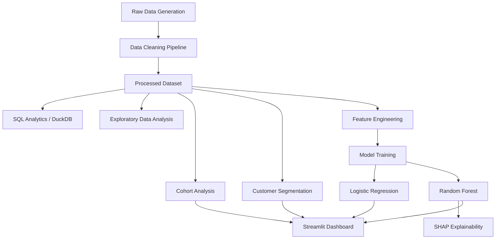

# 📊 Subscription Churn Intelligence System

> A complete end-to-end Data Science portfolio project — from raw data to machine learning to interactive dashboard.


---

## 1. Project Overview

This project builds a **Subscription Churn Intelligence System** for a fictional SaaS company. It answers real business questions using the full data science workflow: data cleaning, SQL analytics, exploratory analysis, cohort analysis, customer segmentation, machine learning, model explainability, and an interactive dashboard.

Built as a weekend portfolio project demonstrating **practical Data Analytics + Data Science + ML skills** through one realistic business problem — without unnecessary complexity.

---

## 2. Business Problem

A subscription-based company wants to:

1. How many customers are churning?
2. What is the overall churn rate?
3. Which subscription plans have the highest churn?
4. Which customer groups are most likely to churn?
5. How does retention change over time?
6. Which customers are currently at high risk?
7. What factors are associated with churn?
8. What actions could reduce churn?

---

## 3. Objectives

| # | Objective | Status |
|---|-----------|--------|
| 1 | Generate realistic synthetic dataset | ✅ |
| 2 | Build data cleaning pipeline | ✅ |
| 3 | SQL analytics with DuckDB | ✅ |
| 4 | Exploratory Data Analysis | ✅ |
| 5 | Cohort retention analysis | ✅ |
| 6 | Customer segmentation (K-Means) | ✅ |
| 7 | Churn prediction (LR + Random Forest) | ✅ |
| 8 | Model explainability (SHAP) | ✅ |
| 9 | Interactive Streamlit dashboard | ✅ |
| 10 | Business insights | ✅ |
| 11 | Tests (39 passing) | ✅ |

---

## 4. Dataset

Synthetic dataset of **5,000 subscription customers** with realistic feature relationships:

| Column | Description |
|--------|-------------|
| `customer_id` | Unique customer identifier |
| `signup_date` | Date customer signed up |
| `plan` | Subscription plan (Basic / Standard / Premium / Enterprise) |
| `monthly_fee` | Monthly charge in USD |
| `age` | Customer age |
| `country` | Country of residence |
| `payment_method` | Credit Card / PayPal / Bank Transfer / Crypto |
| `usage_frequency` | Sessions per month |
| `average_session_minutes` | Avg session duration |
| `support_tickets` | Tickets submitted |
| `payment_failures` | Failed payment attempts |
| `last_login_date` | Date of most recent login |
| `subscription_status` | active / churned / paused |
| `churn_date` | Date of churn (if applicable) |
| `churned` | Target variable: 1 = churned, 0 = active |

**Realistic relationships built in:**
- Low usage → higher churn probability
- Payment failures → strong churn signal
- High support tickets → elevated churn risk
- New customers (< 60 days) → honeymoon effect

---

## 5. Technology Stack

```
Python 3.11+
├── Data Analysis:    pandas, numpy
├── SQL / Database:   DuckDB
├── Visualisation:    plotly, matplotlib, seaborn
├── Machine Learning: scikit-learn (Logistic Regression, Random Forest)
├── Explainability:   SHAP
├── Dashboard:        Streamlit
├── Testing:          pytest
└── Code Quality:     black, ruff
```

---

## 6. Project Architecture



---

## 7. Data Pipeline

```
data/raw/customers_raw.csv          ← Generated by src/data_processing.py
         ↓
   Cleaning Pipeline
   - Remove duplicates
   - Fix invalid ages
   - Impute missing values (median)
   - Parse dates
   - Add tenure features
         ↓
data/processed/customers_clean.csv  ← Used by all notebooks and dashboard
```

---

## 8. Exploratory Analysis

`notebooks/02_eda.ipynb` covers:
- Customer distribution by plan, country, age
- Churn rate overall and by segment
- Usage frequency vs churn relationship
- Payment failures vs churn
- Support tickets vs churn

Key finding: **customers with < 5 sessions/month churn significantly more than high-engagement customers.**

---

## 9. Cohort Analysis

> **What is cohort analysis?** Customers are grouped by the month they signed up. We track what percentage of each cohort is still active in subsequent months.

`notebooks/03_cohort_analysis.ipynb` produces:
- Cohort retention heatmap (rows = cohorts, columns = months since signup)
- Average retention curve across all cohorts
- Monthly churn trend

---

## 10. Customer Segmentation

> **What is K-Means?** An unsupervised algorithm that groups customers into clusters based on behavioural similarity.

Features used: recency, usage frequency, monthly fee, support tickets, payment failures, tenure.

Segments discovered:
| Segment | Characteristics |
|---------|----------------|
| Loyal / High Value | High usage, low failures, long tenure |
| Average / Stable | Moderate engagement, low risk |
| Low Engagement | Low usage, higher churn risk |
| High Risk / At Risk | High failures, low usage |

---

## 11. Churn Prediction

Binary classification: predict whether a customer will churn (1) or not (0).

Two models trained:

| Model | Accuracy | Precision | Recall | F1-Score | ROC-AUC |
|-------|----------|-----------|--------|----------|---------|
| Logistic Regression | 0.868 | 0.977 | 0.822 | 0.893 | 0.938 |
| **Random Forest** | **0.936** | **0.982** | **0.921** | **0.951** | **0.971** |

**Why Recall matters:** Missing a churner (false negative) is more costly than incorrectly flagging a loyal customer. We optimise for recall in production.

---

## 12. Model Evaluation

- Confusion matrix for each model
- ROC-AUC curve comparison
- Precision-Recall trade-off discussion
- Feature importance from Random Forest

---

## 13. Explainable AI (SHAP)

> **What is SHAP?** SHapley Additive exPlanations. For each prediction, SHAP tells you how much each feature pushed the prediction towards "churn" or "no churn".

- Global feature importance: which features matter most overall
- Local explanation: why did THIS customer get THIS score?
- Business-friendly interpretation of model outputs

---

## 14. Dashboard

5-page Streamlit dashboard:

| Page | Content |
|------|---------|
| Executive Overview | KPI cards, churn distribution, plan comparison, trend |
| Customer Retention | Cohort heatmap, retention curves, cohort filters |
| Customer Segments | Cluster distribution, segment profiles, comparison |
| Churn Prediction | Customer lookup, risk score, probability gauge, feature importance |
| Business Insights | Auto-generated findings with business implications |

---

## 15. Key Business Insights

1. **Basic plan customers churn the most** — onboarding improvements needed
2. **Low-usage customers are at-risk** — trigger re-engagement at < 5 sessions/month
3. **Payment failures strongly predict churn** — implement proactive retry logic
4. **High support ticket volume = churn risk** — proactive outreach after 3rd ticket
5. **First 60 days are critical** — structured onboarding significantly impacts LTV

---

## 16. How to Run

### Setup

```bash
git clone https://github.com/yourusername/subscription-churn-intelligence
cd subscription-churn-intelligence
pip install -r requirements.txt
```

### Generate data and train models

```bash
python src/data_processing.py    # generates raw + cleaned data
python train_models.py           # trains and saves ML models
```

### Run the dashboard

```bash
streamlit run dashboard/app.py
```

### Run tests

```bash
pytest tests/ -v
```

### Run SQL queries (DuckDB)

```python
import duckdb
conn = duckdb.connect()
result = conn.execute(open("sql/customer_analysis.sql").read()).fetchdf()
```

---

## 17. Project Structure

```
subscription-churn-intelligence/
├── data/
│   ├── raw/                    ← Generated raw CSV
│   └── processed/              ← Cleaned CSV
├── notebooks/
│   ├── 01_data_cleaning.ipynb
│   ├── 02_eda.ipynb
│   ├── 03_cohort_analysis.ipynb
│   ├── 04_customer_segmentation.ipynb
│   └── 05_churn_prediction.ipynb
├── src/
│   ├── data_processing.py      ← Data generation & cleaning
│   ├── feature_engineering.py  ← ML feature builder
│   ├── cohort_analysis.py      ← Cohort calculations
│   ├── segmentation.py         ← K-Means clustering
│   ├── churn_model.py          ← Model training & evaluation
│   └── visualization.py        ← Reusable Plotly charts
├── sql/
│   ├── customer_analysis.sql
│   ├── churn_analysis.sql
│   └── cohort_analysis.sql
├── dashboard/
│   └── app.py                  ← Streamlit dashboard
├── models/                     ← Saved .pkl model files
├── tests/                      ← Pytest test suite (39 tests)
├── train_models.py
├── requirements.txt
├── .gitignore
├── LICENSE
└── README.md
```

---

## 18. Future Improvements

- [ ] Add survival analysis (time-to-churn modelling)
- [ ] XGBoost / LightGBM model comparison
- [ ] Automated retraining pipeline
- [ ] Deploy to Streamlit Community Cloud
- [ ] Add email alert system for high-risk customers
- [ ] A/B test framework for retention interventions

---

## Key Concepts for Interviews

| Term | Definition |
|------|-----------|
| **Churn Rate** | % of customers who cancelled in a given period |
| **Retention Rate** | % of customers still active after N months |
| **Cohort Analysis** | Comparing groups of customers who joined at the same time |
| **RFM** | Recency, Frequency, Monetary — classic customer value framework |
| **K-Means** | Unsupervised algorithm that groups data into K clusters |
| **Train/Test Split** | Holding back data to evaluate model on unseen examples |
| **Precision** | Of predicted churners, how many actually churned? |
| **Recall** | Of actual churners, how many did the model catch? |
| **F1-Score** | Harmonic mean of precision and recall |
| **ROC-AUC** | How well the model separates churners from non-churners |
| **SHAP** | Method to explain individual ML predictions |
| **Data Leakage** | When test data information contaminates the training process |
| **MRR** | Monthly Recurring Revenue |

---

*Built with Python · pandas · scikit-learn · DuckDB · Streamlit · SHAP*
